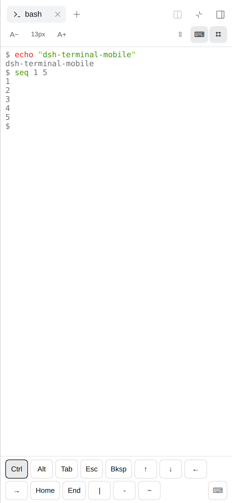

# dsh-terminal-mobile

A mobile-first replacement for the DSH web right-sidebar terminal screen.



The official package keeps everything it already owns — the tab type, the PTY,
the session binding, reconnect, cleanup and the guide card. This plugin shadows
**only the rendered screen** (the `sidebar.right.pane.tab` cell of the official
terminal package) at a lower slot priority, and adds what a phone needs:

- **Adjustable font size** — `A− 13px A+`, 9–28 px, applied without rebuilding
  the emulator (scrollback survives).
- **A Termux-style extension key bar** — Ctrl/Alt sticky modifiers, arrows,
  Home/End, Tab/Esc/Bksp, punctuation; user-editable, including custom keys with
  escape payloads.
- **The key bar wraps instead of scrolling sideways** — a newly added key can
  never hide off-screen behind an invisible scrollbar.
- **Touch scrolling that belongs to the terminal** — with a toolbar switch for
  scrolling the page instead.
- **A soft keyboard that stays down until asked for** — and a toolbar toggle that
  raises it inside the tap's own gesture.
- **Keyboard-aware layout** — the visual-viewport inset lifts the whole screen
  (key bar included) above the soft keyboard.

## Install

```bash
git clone https://github.com/ThraceShah/dsh-terminal-mobile.git
dsh plugin --profile web add "$PWD/dsh-terminal-mobile"
```

Refresh the running GUI (the profile's bundle list changed). Remove with:

```bash
dsh plugin --profile web remove @local/dsh-terminal-mobile
```

The official terminal screen comes back as soon as the plugin is gone; nothing
about the terminal provider is modified.

Installing needs `pnpm` on `PATH` (`dsh plugin` forwards to it). The build
artifacts are committed, so installing does **not** run a build.

## Develop

```bash
npm install          # esbuild + xterm + react (dev only; nothing is a runtime dep)
node build.mjs       # writes client.js and client.terminal-mobile.js
npm test             # load + logic + body (no browser, no server)
```

The browser tests need a running `dsh web` — install the plugin into a **fresh
`DSH_HOME`** first, because every test that opens a tab consumes one of the
session's ~8 terminals and a reused home eventually fails with `terminalLimit`:

```bash
export DSH_HOME=$(mktemp -d)
dsh plugin --profile web add "$PWD"
dsh web --no-open            # prints http://127.0.0.1:3080/?token=...

node test/served.mjs    <baseUrl> <token>
node test/geometry.mjs  <baseUrl> <token>
node test/e2e.mjs       <baseUrl> <token>
node test/roundtrip.mjs <baseUrl> <token>
node test/wrap.mjs      <baseUrl> <token>
node test/mobile.mjs    <baseUrl> <token>
node test/capture.mjs   <baseUrl> <token>
```

`<token>` is the `?token=` value the server prints on startup. For a server whose
token you no longer have, pass a ready cookie instead:
`DSH_COOKIE='name=value' node test/e2e.mjs http://127.0.0.1:3080 ""`.

The browser tests use Playwright (`npm i` installs it; run
`npx playwright install chromium` once).

## Preferences

Stored in browser `localStorage` under `dsh.terminal-mobile.v1`:

```jsonc
{
  "fontSize": 13,
  "scrollMode": "terminal",        // or "page"
  "keyBar": {
    "enabled": true,
    "keys": ["ctrl", "alt", "tab", "esc", "backspace", "up", "down", "left", "right", "home", "end", "pipe", "dash", "tilde"],
    "custom": [{ "id": "…", "label": "Home2", "send": "\u001b[1~" }]
  }
}
```

The soft-keyboard switch is intentionally **not** persisted.

Debug frame capture: `localStorage.setItem('dsh.terminal-mobile.debug', '1')`,
then read `window.__dshTerminalMobileCapture.frames`.

## Layout

```
index.js                 host half (empty apply; the Loader needs a row)
cordis.patch.yml         bundle layer inserting the plugin row
client.js                built entry: locale + keyed slot registration
client.terminal-mobile.js  built chunk: xterm, screen, key bar, editor
build.mjs                esbuild wrapper (ModuleLoader envelope + inlined xterm CSS)
src/                     sources
test/                    Node and browser suites
```

Architecture notes and the pitfalls this design avoids are in
[docs/ARCHITECTURE.md](docs/ARCHITECTURE.md).

## Compatibility

Built and tested against DSH `0.2.0-rc.2` / `@deepseek-ai/dsh-client-ui-sidebar-terminal`
`0.2.0-rc.2`, xterm `6`, React `18`. The plugin depends on the official
package's slot key, its `webTerminals` model and its `sidebarTerminal` locale, so
a DSH release that renames those would need a matching update here.

## License

[MIT](LICENSE)
